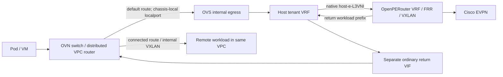

# Экспериментальная реализация

Основа: Kube-OVN branch `openperouter`, исходный HEAD
`8bd912fefaa0a497384bde2ad2c42906e3a14c9c`; OpenPERouter
`Mac_setings_for_l2vni_and_l3vni@60a1285935b10eb0b1cf07e4533faefedde3d4d3`.
Изменения не развёрнуты. До закрытия release blockers ниже режим нельзя
считать выполнением всех требований или готовым решением для production.

## Datapath и владение



На VPC создаётся один transit switch с LRP `.1`, общий localport `.2` и
обычный return LSP каждой ноды (`nodeIndex+3`). Существующий distributed
router VPC сохраняется. В OVN добавляется один default на IP localport на
семейство; маршруты Cisco и их next-hop в OVN не копируются. Connected
маршруты tenant Subnet длиннее default, поэтому доставка внутри VRF идёт
напрямую через OVN, включая внутренний VXLAN между нодами. Между VPC нет
peering или route leaking. Меж-VRF external connectivity задаёт Cisco RT/policy.

`localport` выбран после чтения `controller/physical.c` OVN branch-26.03,
reviewed commit `d84ae4079af6124793a6d7538f544b5e63f5f71a`. Образ этой ветки
Kube-OVN собирается с branch-26.03. Localport input не пересылается на другой
chassis; multicast output добавляется в originating-chassis processing, а
не повторно на chassis, принявшем tunnel copy. Origin-only BUM, local egress и return delivery дополнительно проверены
реальными packet captures на OVS 3.7.1 / OVN 26.03.0 (см. отчёт).
`localnet`, gateway chassis, per-IP policies и ECMP между K8s gateways не используются.

Host VRF содержит два owned OVS internal интерфейса: `opre<hex VNI>` и
`oprr<hex VNI>`. Их IP/MAC и `iface-id` управляет daemon. Native veth
`host-e-<VNI>` создаёт и восстанавливает только OpenPERouter; daemon проверяет
его тип, адреса/MTU, подключает host leg к своему VRF и переобнаруживает ifindex.
Router-side leg, Linux VXLAN, bridge/FDB и FRR принадлежат OpenPERouter.
Удаление Kube-OVN объектов не удаляет native veth, FRR configuration или
native L3/L2VNI. За их lifecycle отвечает configuration management.

Host VRF table = `100000 + L3VNI`; до открытия ingress устанавливаются
unreachable defaults обоих семейств. Default с меньшей metric идёт только
на свой PE, workload subnet routes — только на return VIF. На transit LS ACL
отбрасывает вход с egress-only localport. Вход с return VIF разрешён только
к CIDR своего VPC; неизвестная внешняя цель отбрасывается до повторного default.
Return VIF входят в один owned Port_Group на VRF; ACL использует положительный
`inport == @group` и отдельные IPv4/IPv6 allowlists. Отрицательное сравнение
с router-facing LSP и смешанная negated dual-stack allowlist не обеспечили
изоляцию в реальном OVN lab и заменены после packet tests.
Ownership проверяется по Kubernetes UID в external_ids/VRF alias; чужие
объекты с совпавшими именами не присваиваются. Удалённые return LSP теряют
strong reference, orphan cleanup сохраняет основной VPC router.

## Доступность workload и BGP

Host-side speaker GoBGP запускает kube-ovn daemon отдельно для каждого host
VRF, bind-to-device, active-only TCP, без listener и Graceful Restart. На host
нет второго FRR. Источник BGP NLRI — свежий API list локальных Pending/Running
Pods, Kube-OVN allocation annotations, установленный OVS iface и активное
OVN SB владение. PodReady не определяет доступность маршрута. Только /32 и
/128. Подготовленный target не анонсирует; после RARP учитывается
`additional-chassis-activated`, даже пока primary остаётся source. VMI-owner
port naming учтён.

SB monitor условный: один Chassis и Port_Binding, где нода — primary либо
additional chassis (OR). Из additional выбирается только RARP-активированный
владелец. Дополнительно отслеживаются точные имена MAC Address_Set нужных
L2 subnet, без копирования всех внешних маршрутов.
Внешние маршруты host speaker не импортирует и в host FIB не устанавливает.
Native hostSession имеет отдельные ASNs PE/host (пример 64514/64515).
EVPN/unnumbered Cisco peering, RT/RD, VTEP IPAM полностью остаются native
bootstrap OpenPERouter. Общий ASN host не требует импорта remote host routes
назад в speaker; AS_PATH interoperability всё равно нужно проверить с Cisco.

Availability lease существует только в памяти процесса, максимум 30s.
В текущей реализации ошибка fresh Pod list приводит к немедленному отзыву
на следующей итерации (обычно до 5s + API timeout), даже до истечения lease.
Ошибка SB/OVS/bootstrap также отзывает workload routes и закрывает все
найденные owned attachments, включая оставшиеся от прошлого процесса.
После reboot config cache никогда не восстанавливает workload advertisements.
При native interface recreation fingerprint меняется, speaker пересоздаётся.
Hold/keepalive host BGP: 9/3s; при аварийном завершении отзыв зависит от hold
peer, при штатном обнаружении выполняется явный withdraw. Это не SLA.
При большой обработке/таймаутах фактические сроки могут быть больше.

## Внешний L2

На Subnet создаётся один общий `localport` с `addresses: unknown`.
На каждой ноде host-side путь теперь следующий (имена кодируют VNI в hex):

```text
PE namespace → native host-e-L2VNI → owned bridge oplb<VNI>
  → owned veth oplp<VNI> ↔ oplf<VNI> [nft ingress] → br-int/localport
```

`hostMaster` в OpenPERouter должен отсутствовать: host bridge и частная
veth pair принадлежат Kube-OVN, native veth создаёт только OpenPERouter.
Alias bridge/pair содержит VPC UID и Subnet UID. Kube-OVN не меняет
FDB/neighbors внутри PE. Старое прямое подключение native veth к OVS
закрывается и удаляется только при совпадении владельца.

Пользовательский OVN ACL остаётся дополнительной защитой; reserved ND allow
может его обходить. Основная защита — nftables `netdev` ingress
`ether saddr @macs drop` на **частном** `oplf`, для всех EtherTypes.
Исходящий migration RARP не фильтруется. Native veth recreation не удаляет
этот hook и не может открыть частную veth; после host reboot её вообще нет
до подготовки daemon. Замена nft table/set/chain атомарна. Имена таблиц
и ownership comment привязаны к Subnet UID.

До `createLogicalSwitchPort` controller выполняет протокол допуска:

1. MAC добавляется в NB Address_Set. Набор **монотонный до удаления Subnet**:
   удаление Pod не удаляет защиту MAC. Внешний endpoint с ранее использованным
   OVN MAC останется отфильтрованным до удаления этой сети; перенос такого MAC
   из OVN во внешний L2 не поддерживается этим admission-протоколом.
   Это конфигурация фильтра, не доступность
   workload и не основание BGP-анонса.
2. В namespaced ConfigMap `kube-ovn-opr-guard-<hash Subnet UID>` публикуются
   SHA256 ревизия полного набора. `Publish` не читает Nodes и не создаёт
   участников: членство появляется только через daemon `JoinClosed` после
   закрытия локального пути под host flock. При пустом списке участников
   admission проходит: ещё ни один путь не получил разрешения открыться.
   Ранее зарегистрированные участники сохраняются даже после удаления Node.
   Старые Pending placeholders с пустой Session, созданные прежним Publish,
   удаляются при следующей публикации; они никогда не разрешали открытие.
   Pending с непустой Session не удаляется.
3. Каждый daemon сначала закрывает локальную частную veth и регистрирует
   новую UUID сессию как `closed`. Перед открытием делает CAS `pending`,
   устанавливает актуальный scoped SB MAC set, делает CAS `active` с точной
   ревизией, повторно читает API для проверки UID/session/revision/Active
   и только затем поднимает частную veth. Ошибка подготовки, ACK или финального
   чтения не разрешает Open; смена revision требует повторной подготовки.
   На стабильной Active revision новых Pending/ACK записей нет.
   `closed` подтверждает
   физически закрытый край; `pending` никогда не разрешает новый MAC.
4. Controller требует от **всех** участников `closed` либо `active` с текущей
   ревизией, записывает допущенные MAC в отдельный NB Address_Set `_ready`
   и только после успеха разрешает создание workload LSP. Ошибка возвращается
   штатному retry pod handler; фиксированных задержек нет.

Interleavings допуска и открытия:

| Порядок событий | Почему безопасно |
| --- | --- |
| Ready прочитал пустое членство/Closed, затем daemon вступил | Путь закрыт. InstallIntent проверяет текущую revision через CAS; фильтр полного набора установлен до Open. |
| InstallIntent закоммитился раньше Ready | Pending блокирует новый MAC до ACK. CAS conflict заставляет перечитать revision/session, stale intent не коммитится. |
| Publish изменил revision во время install или перед ACK | ACK старой revision отклоняется; Open не вызывается. |
| Publish/session change между ACK и финальной проверкой | Свежий API read отклоняет Open. |
| Publish после финальной проверки, непосредственно перед LinkSetUp | Это не атомарная API/kernel транзакция. Сохраняется фильтр прежней revision; Active ACK этой revision блокирует admission новых MAC следующей revision. До их допуска daemon обязан установить новый полный набор. |
| Новый процесс после restart | Host flock не допускает overlap; сохранённый путь закрывается до JoinClosed новой session. Старые ACK/Open authorization отвергаются. |

ResourceVersion CAS, UID ConfigMap/Node/Subnet и UUID сессии исключают старые
ACK. UID barrier закреплён также в NB: потеря/пересоздание ConfigMap блокирует
новые admissions, а не забывает отключённый открытый край. Восстановление
после ручного удаления barrier требует подтверждённого закрытия всех прежних
attachments и пересоздания Subnet; удалять barrier при работающей сети нельзя.

Host flock в общем `/var/run/openvswitch` исключает перекрытие старого и нового
процессов daemon. Startup закрывает сохранённые attachments до чтения cache;
Node без daemon вообще не является участником и не блокирует admission.
После старта daemon новая нода регистрирует `closed` до проверки PE bootstrap.
При смене Node UID в работающем daemon сначала Fence и Closed старой identity,
затем регистрация новой. Старый member не стирается; если закрытие или API update
не удались, новая identity не получает доступ. При restart на другом host старый
member сохраняется и требует отдельного доказанного закрытия. Она не откроет край
без актуального набора. Потеря API/SB вызывает Fence; `closed` публикуется
только после успешного закрытия. Если связь потеряна, старый `active` ACK новой
ревизии не подходит. Безопасного timeout eviction нет: отключённая нода с
потенциально открытым краем блокирует **новые MAC** до возврата или доказанного
закрытия. Для обновления существующей установки сначала закрыть legacy direct
attachments на всех нодах и обновить daemons; смешанная версия не допускается.

Уже допущенный постоянный MAC VM использует `_ready`: target migration
не ждёт новых MAC чужих workloads. Он по-прежнему не получает Type-5 только
из-за наличия target launcher/PodReady. После restart daemon, пересоздания
native veth или attachment актуальная защита устанавливается до открытия.
Unknown source MAC workload запрещён в L2 режиме. Полный Cisco/KubeVirt E2E
и измерения convergence этим протоколом не подменяются.

Оба Helm charts выдают `kube-ovn-cni` namespaced Role get/create/update
ConfigMaps только при `openperouter.enabled`. В standalone deployment нужны
те же права в namespace Kube-OVN; controller должен сохранять свои штатные
права get/create/update ConfigMaps. Bootstrap OpenPERouter от этих ConfigMaps
не зависит: это admission host attachments после запуска Kubernetes.

Внутренний BUM доставляет OVN; локальный originating copy выходит через PE.
Fabric ingress предназначен только локальным workloads. При миграции OVN
RARP activation / active binding переключает Type-5 ownership, а native EVPN MAC mobility
должен переключить Type-2 по кадрам нового владельца/GARP/NA.
Публикация/aging Type-2 принадлежит Linux bridge/neighbour/FRR OpenPERouter.
Kube-OVN не выполняет `bridge fdb`, `ip neigh` или `vtysh` для изменения native
state. Явный немедленный delete Type-2 по удалению Pod в этом API отсутствует;
используется native aging, чего недостаточно для обещания быстрого удаления.

OVN LRP и native IRB имеют одинаковый gateway IP/MAC из Subnet/bootstrap;
общий MAC `02:00:05:00:03:00`. Host speaker не является gateway IP owner.
Один node routerMAC задаётся bootstrap и применяется ко всем native L3VNI.
Уникальность node index/RMAC проверяет controller по Node annotations.

## API, Services и политики

`Vpc.spec.openPERouter` задаёт mode, VRF, native L3VNI reference/ID,
transit/host session pools и ASNs. `Subnet.spec.openPERouterL2` ссылается на
L2VNI и задаёт gateway MAC. Pod-only Subnet не нуждается в L2VNI.
RT/RD, VTEP pools и fabric neighbors — декларативные native поля
`openpe_*.yaml`; Kube-OVN не зеркалирует их в конкурирующий API.
Настройки attachment immutable. Смешивание с legacy NAT, VLAN/U2O,
centralized gateway, VPC peering и собственными static/policy routes запрещено.
Management/default VPC для интеграции запрещён.

Существующие OVN LoadBalancer и NetworkPolicy paths сохранены. Service
должен быть привязан к tenant VPC аннотацией `ovn.kubernetes.io/vpc`.
Внутренний ClusterIP DNAT выполняет OVN до external egress. Return fence
пока разрешает workload CIDRs; внешние Service VIP/NodePort advertisements
этот speaker **не реализует**. NodePort/LB со всеми trafficPolicy, hairpin,
external L2 ingress/egress NetworkPolicy и migration требуют отдельных тестов.
Нельзя объявлять полную Service support только из факта сохранения LB кода.

В owned gateway iptables/nftables chains добавлены interface-scoped
исключения SNAT и FORWARD для `host-e-*`/`oprr*`, без tenant-prefix match.
Они не управляют чужими firewall chains и их base policies. Root и PE
conntrack namespaces общие для своих VRF: overlapping tenant tuples и
root-local address collisions не проверены. Не применять overlapping CIDR
в disposable примере до проверки conntrack zones/local routing rules.

## Bootstrap и восстановление

Локальные Ansible/systemd: images, kernel modules, dedicated fabric NIC,
node-config, openpe definitions, FRR initial files и полный набор upstream
Quadlets. Kube-OVN не устанавливает PE и не пишет bootstrap. Каталог
смонтирован daemon read-only. API недоступен при boot: PE underlay/EVPN
поднимаются по local static input, workload routes не восстанавливаются.
Native definitions с одинаковыми именами не должны параллельно изменяться
Kubernetes native OpenPERouter operator и configuration management.

Порядок: fabric NIC/modules/sysctls → router namespace/FRR/reloader и static
controller → native interfaces → OVS/ovn-controller → kube-ovn host attachment
и fresh binding/API → host BGP announcements. Зависимость PE от kubelet или
Kube-OVN не добавлять. Точный набор upstream Quadlets из закреплённого commit
сохранять целиком; заменить `:main` на digest собранного image.

Предложенная тестовая база: Linux 6.12 LTS, Podman >=5.4 с `.pod` Quadlet,
systemd 257, FRR 10.6.0 и OVN branch-26.03. Это **не доказанный минимальный
набор версий**. OpenPERouter отмечает kernel >=5.18 для accept_untracked_na.
Нужны IPv4/IPv6 forwarding, rp_filter=0 на tenant forwarding interfaces
(и не strict в conf.all), socket l3mdev_accept=0 для изоляции host services.
Глобальные sysctls подготавливает Ansible, daemon не меняет их незаметно.

MTU: workload MTU ≤ min(internal underlay MTU − OVN overhead,
fabric MTU − native EVPN overhead). Native host-veth MTU также проверяется.
В нормальном egress пакете OVN tunnel уже снят до external VXLAN, поэтому
50+50 не вычитаются автоматически как nested tunnels. IPv6 outer требует
70 вместо 50 bytes; VLAN/дополнительные headers учитывать отдельно.

## Блокеры и неподтверждённые свойства

1. **PE unreachable defaults — отложенная зависимость OpenPERouter.** В выбранном
   SHA `internal/hostnetwork/vrf.go:setupVRF/createVRF` создаёт и поднимает VRF
   без kernel terminal default. `internal/hostnetwork/vni.go:SetupL3VNI`
   затем создаёт host veth. `api/v1alpha1/l3vni_types.go:L3VNISpec` не содержит
   fail-closed/readiness контракта. Защитные terminal defaults должны
   устанавливаться kernel reconciler OpenPERouter; дублирование через
   FRR не требуется и не устраняет окно до FIB installation. В примере
   и bootstrap validator Kube-OVN требования RawFRRConfig/Null0 нет. Reconcile в
   `internal/controller/routerconfiguration/reconcile.go` применяет FRR
   **до** datapath, что снижает риск, но не ждёт установки маршрута после
   kernel VRF_NEW. При пересоздании VRF/отказе FRR гарантия drop до main lookup
   не следует из кода. `net.vrf.strict_mode` ограничивает совместное
   использование table ID и не заменяет unreachable default.
   В отдельном Linux component test теперь воспроизведён main-table
   fallthrough без terminal default (2 внешних ICMP packets против 0 с
   unreachable default); полный PE restart этим тестом не проверен.
   История upstream: [issue #227](https://github.com/openperouter/openperouter/issues/227)
   закрыт 2026-06-16 после merge [PR #242](https://github.com/openperouter/openperouter/pull/242).
   Исправление `8a357c6631785672b0d61f1dc9e5a51348e7b83c` добавляло
   `ensureUnreachableDefaultRoutes` для IPv4/IPv6 с metric 4278198272.
   Оно [откачено 2026-07-06](https://github.com/openperouter/openperouter/commit/73c34a2b13ff25f20cecff505d72c51ca6041450)
   из-за несовместимости с SRv6; продолжение — открытый
   [issue #516](https://github.com/openperouter/openperouter/issues/516).
   В закреплённом SHA MAC-ветки этих функций/маршрутов нет. Закрытие #227
   поэтому не снимает блокер. Для нашей VXLAN EVPN архитектуры можно
   опереться на подход #242, ограничив его EVPN VRF и проверив порядок
   открытия ingress и восстановление; SRv6 в целевой datapath не входит.
   В рамках Kube-OVN это не исправляется и не останавливает независимые
   работы. Ветка unreachable-route не является контрактом интеграции.
   Для будущей доработки native owner нужны
   идемпотентная установка terminal IPv4/IPv6 defaults в `setupVRF` до
   поднятия/подключения tenant ingress, включая recreate; не снимать их
   при потере BGP/FRR. Нужны kernel fault/restart tests. Kube-OVN не должен
   устанавливать эти маршруты внутри PE namespace обходным netlink/script.
2. **Детерминированный delete Type-2 на workload delete не реализуется через
   существующий native L2VNI API.** Оно описывает сегмент, не endpoint lease.
   Нужна проверка native aging и EVPN mobility. Если требуется немедленный
   withdraw с конкретным сроком, минимальное upstream расширение — endpoint
   availability/lease API у native владельца FDB/FRR, без второго reconciler.
3. **Масштаб распределённого L2 admission не измерен.** Барьер закрывает
   допуск нового MAC до защиты всех потенциально открытых краёв. Потеря
   участника сознательно ограничивает допуск новых identities. Полная
   KubeVirt/EVPN mobility и Type-2 lifecycle пока не испытаны.
4. **Полная E2E матрица не выполнена.** Компонентный OVN lab подтвердил
   local handoff, BUM и LB/ACL, но не Cisco ECMP/AS_PATH, полный PE withdraw,
   conntrack isolation, Kubernetes controllers или KubeVirt migration.

GR отключать с обеих сторон host/fabric sessions на испытании отказа;
BFD/holdtime и remote graceful-restart stale retention определяют окно
продолжения трафика до withdraw. BFD в GoBGP host speaker не добавлен.
После полного external withdrawal host default остаётся только на local PE;
OVN маршрута на другую ноду как gateway нет. Доставка к remote workload
того же VRF продолжает использовать OVN независимо от внешних маршрутов.

## Масштаб (расчёт, не нагрузочный тест)

N — ноды, R — VRF/VPC, L — внешние L2 Subnet, W — endpoints.
Все приведённые cluster counts предполагают, что VRF есть на каждой ноде.

| Объект | Формула | 250 нод, R=1,L=2 | 1000 нод, R=1,L=2 |
| --- | --- | ---: | ---: |
| OVN routers | R, существующие | 1 | 1 |
| Transit switches | R | 1 | 1 |
| Transit LSP (router/localport/return) | 2R+NR | 252 | 1002 |
| L2 localport | L | 2 | 2 |
| Новые ACL / MAC Address_Set | 2R+L / 2L | 4 / 4 | 4 / 4 |
| Host private bridge/veth devices | 3NL | 1500 | 6000 |
| Barrier ConfigMaps / member records | L / NL | 2 / 500 | 2 / 2000 |
| Return Port_Group / membership | R / NR | 1 / 250 | 1 / 1000 |
| Egress defaults | R на IP family | 1 | 1 |
| Per-node egress policies | 0 | 0 | 0 |
| Host VRF | NR | 250 | 1000 |
| Owned internal host interfaces | 2NR | 500 | 2000 |
| Native veth pairs L3+L2 | N(R+L) | 750 | 3000 |
| Native bridge+VXLAN devices в PE | 2N(R+L) | 1500 | 6000 |
| Native PE VRF | NR | 250 | 1000 |
| Host BGP sessions / family | NR | 250 | 1000 |
| Host ingress policy rules (active) | 4N(3R+3L) | 9000 | 36000 |
| Host nft table/set/chain, каждого | NL | 500 | 2000 |

Это additions к существующим workload LS/LSP/LRP. Возвратные порты создают
SB bindings O(NR); multicast/OVN flows должны быть измерены. Два MAC набора
хранят O(уникальных MAC за жизнь Subnet); старые identities освобождаются
при удалении сети. Это стоимость монотонного доказательства admission,
без availability announcements из кэша. NB additions используют set insert;
Pod prepare всё ещё читает весь L2 switch: O(W_L2) cache work. Полный SB set
и nft transaction передаются целиком: для 50k MAC это около 1 MB строк с
JSON overhead, без репликации. Нужны измерения до заявления о масштабе 1000.
На ревизию требуется O(M) Pending/ACK CAS, каждый меняет целый ConfigMap
с O(M) members конкретного сегмента (M — зарегистрированные, включая
сохранённых отключённых участников);
при одновременных ACK возникают retries/conflicts. Stable active revision
не вызывает ACK write. Это существенный предел admission throughput;
batching и шардирование требуют отдельного анализа, не подтверждены нагрузкой.
Type-5 host routes O(W), Type-2 O(W_L2), fabric imports зависят от RT и route
reflectors. Например 100 endpoints/node → 25k/100k host NLRI на один stack,
в каждом полном fabric VRF RIB возможно O(W). В OVN нет O(N×external routes).

Каждый daemon fresh-lists local Pods раз в 5s: baseline 50/200 API list/s
для 250/1000 нод; это заметная стоимость API и причина отдельного нагрузочного
теста/возможного lease protocol, без ослабления boot freshness. Общие informer
traffic и response bytes сюда не включены. SB binding monitor хранит только
local primary/additional bindings, но controller получает обычные cluster informer caches.
Дополнительно guard reconcile делает свежий Node.Get и примерно три
ConfigMap.Get на локальный L2 attachment за 5s (registration, prepare и pre-Open).
Для L=2 это около 300/1200 CM GET/s и 50/200 Node GET/s при 250/1000 нодах,
без retries и informer traffic. Nodes.List для admission удалён. Pending/ACK
меняют целую запись зарегистрированных участников, не список Kubernetes Nodes. Эти затраты требуют
отдельного нагрузочного теста; они не относятся к bootstrap OpenPERouter.
Topology scan каждые 10s читает O(NR), stable desired rows не должны писать
OVN DB. Новая/удалённая нода меняет O(R) return ports; новые workload MAC
меняют O(L) address set содержимое соответствующего сегмента, не per-IP policy.

Массовый withdraw Cisco обрабатывают локальные PE RIB/FIB, без публикации
каждого внешнего маршрута в API/NB/SB. Массовая потеря API/SB вызывает O(W)
workload withdrawals и O(NR+NL) закрытий локальных attachments, что требует
проверки FRR RR queues, CPU, convergence и API recovery jitter. Текущие
периоды polling не являются обоснованием готовности к 1000 нодам.


## Точные исходники release blockers

Все ссылки закреплены на выбранном commit, а не на подвижной ветке:

* [kernel setupVRF/createVRF](https://github.com/Egor-Ozhmegoff/openperouter/blob/60a1285935b10eb0b1cf07e4533faefedde3d4d3/internal/hostnetwork/vrf.go#L34)
* [SetupL3VNI и host leg lifecycle](https://github.com/Egor-Ozhmegoff/openperouter/blob/60a1285935b10eb0b1cf07e4533faefedde3d4d3/internal/hostnetwork/vni.go#L114)
* [Порядок FRR/datapath reconciliation](https://github.com/Egor-Ozhmegoff/openperouter/blob/60a1285935b10eb0b1cf07e4533faefedde3d4d3/internal/controller/routerconfiguration/reconcile.go#L76)
* [L3VNI API](https://github.com/Egor-Ozhmegoff/openperouter/blob/60a1285935b10eb0b1cf07e4533faefedde3d4d3/api/v1alpha1/l3vni_types.go)
* [RawFRRConfig API](https://github.com/Egor-Ozhmegoff/openperouter/blob/60a1285935b10eb0b1cf07e4533faefedde3d4d3/api/v1alpha1/rawfrrconfig_types.go#L37)
* [L2VNI API](https://github.com/Egor-Ozhmegoff/openperouter/blob/60a1285935b10eb0b1cf07e4533faefedde3d4d3/api/v1alpha1/l2vni_types.go)

## Host attachment isolation и teardown

На host-side L3 и L2 ingress Kube-OVN устанавливает policy rules protocol 202
для каждого из egress/return/native host-veth и обоих IP families:
priority 900 `iif <attachment> lookup <tenant-table>`, priority 901
`iif <attachment> unreachable`. Сначала создаётся terminal rule, затем lookup,
затем открывается attachment. Даже после потери VRF master lookup не доходит
до main. Rules привязаны к имени и сохраняются при recreation native veth.
Fence временно закрывает ingress: internal OVS rows остаются для восстановления.
Cleanup — окончательное удаление: проверяются UID Interface и Port, ingress
закрывается, terminal drop восстанавливается даже для частично созданного
старого attachment, собственный lookup снимается, удаляются Port/Interface **включая
internal**, затем закрываются/отсоединяются native slaves и удаляется owned
host VRF. Native veth никогда не удаляется. Повтор после частичной ошибки
завершает удаление и позволяет новый VPC UID с тем же L3VNI.

Для L2 удаляется частный owned bridge/veth path и NFT table. Собственные
priority 900 lookups удалённой привязки снимаются; priority 901 terminal drop
сохраняется для повторно поднятого native имени. При последовательном reuse
L2VNI в другом VRF новый attachment остаётся закрытым. Проверяются отсутствие
действующей/чужой OVS или Linux привязки и свободный native master. В обоих
семействах сначала ставится временный priority 899 unreachable, затем
снимаются старые собственные 900 и добавляются новые 900 lookup новой таблицы.
После подготовки фильтра и ACK 899 снимается; 901 остаётся постоянно.
Частичная ошибка сохраняет 899; повторный reconcile завершает переход.
Чужие RPDB rules отклоняются, не удаляются. Горячий перенос действующего
Subnet между VRF не поддерживается: сначала удалить subnet/native config,
дождаться cleanup, затем создать новую привязку.

Terminal rules сохраняются и для исторически использованных имён: их число
зависит от числа разных VNI за жизнь хоста, а не только активных сетей.
Активный L2 attachment имеет по 4 rules на native, private guard и bridge
(IPv4/IPv6 lookup+terminal); переход добавляет временные 899. Guards не
касаются обычного host underlay и внешних VXLAN packets внутри PE.
Nft table/set/chain — по одному на attachment, O(MAC сегмента).

Host→PE BGP readiness проверяется через GoBGP ListPeer для всех настроенных
семейств. Host VRF/return leg могут быть подготовлены до сессии, но egress
остаётся down, L2 ещё не открывается и workload NLRI не публикуются.
При потере host session owned attachments закрываются; внутренний OVN
workload-to-workload путь от этого не зависит. Established host session
не доказывает наличия внешних Cisco маршрутов и не закрывает отложенное
ограничение PE defaults.
