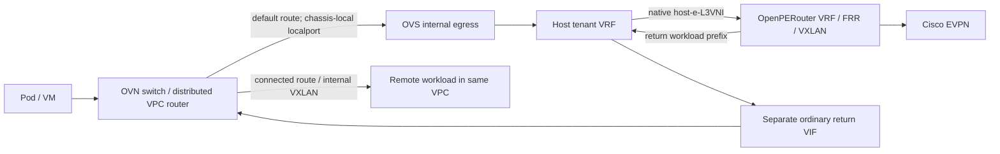

# Экспериментальная реализация

Основа: Kube-OVN branch `openperouter`, исходный HEAD
`8bd912fefaa0a497384bde2ad2c42906e3a14c9c`; OpenPERouter
`Mac_setings_for_l2vni_and_l3vni@60a1285935b10eb0b1cf07e4533faefedde3d4d3`.
Изменения не развёрнуты. До закрытия release blockers ниже режим нельзя
считать выполнением всех требований или готовым решением для production.

## Datapath и владение

На VPC создаётся один transit switch с LRP `.1`, общий localport `.2` и
обычный return LSP каждой ноды (`nodeIndex+3`). Существующий distributed
router VPC сохраняется. В OVN добавляется один default на IP localport на
семейство; маршруты Cisco и их next-hop в OVN не копируются. Connected
маршруты tenant Subnet длиннее default, поэтому доставка внутри VRF идёт
напрямую через OVN, включая внутренний VXLAN между нодами. Между VPC нет
peering или route leaking. Меж-VRF external connectivity задаёт Cisco RT/policy.

`localport` выбран после чтения `controller/physical.c` OVN branch-26.03,
reviewed commit `d84ae4079af6124793a6d7538f544b5e63f5f71a`. Образ этой ветки
Kube-OVN собирается с branch-26.03. Localport input не пересылается на другой
chassis; multicast output добавляется в originating-chassis processing, а
не повторно на chassis, принявшем tunnel copy. Origin-only BUM, local egress и return delivery дополнительно проверены
реальными packet captures на OVS 3.7.1 / OVN 26.03.0 (см. отчёт).
`localnet`, gateway chassis, per-IP policies и ECMP между K8s gateways не используются.

Host VRF содержит два owned OVS internal интерфейса: `opre<hex VNI>` и
`oprr<hex VNI>`. Их IP/MAC и `iface-id` управляет daemon. Native veth
`host-e-<VNI>` создаёт и восстанавливает только OpenPERouter; daemon проверяет
его тип, адреса/MTU, подключает host leg к своему VRF и переобнаруживает ifindex.
Router-side leg, Linux VXLAN, bridge/FDB и FRR принадлежат OpenPERouter.
Удаление Kube-OVN объектов не удаляет native veth, FRR configuration или
native L3/L2VNI. За их lifecycle отвечает configuration management.

Host VRF table = `100000 + L3VNI`; до открытия ingress устанавливаются
unreachable defaults обоих семейств. Default с меньшей metric идёт только
на свой PE, workload subnet routes — только на return VIF. На transit LS ACL
отбрасывает вход с egress-only localport. Вход с return VIF разрешён только
к CIDR своего VPC; неизвестная внешняя цель отбрасывается до повторного default.
Return VIF входят в один owned Port_Group на VRF; ACL использует положительный
`inport == @group` и отдельные IPv4/IPv6 allowlists. Отрицательное сравнение
с router-facing LSP и смешанная negated dual-stack allowlist не обеспечили
изоляцию в реальном OVN lab и заменены после packet tests.
Ownership проверяется по Kubernetes UID в external_ids/VRF alias; чужие
объекты с совпавшими именами не присваиваются. Удалённые return LSP теряют
strong reference, orphan cleanup сохраняет основной VPC router.

## Доступность workload и BGP

Host-side speaker GoBGP запускает kube-ovn daemon отдельно для каждого host
VRF, bind-to-device, active-only TCP, без listener и Graceful Restart. На host
нет второго FRR. Источник BGP NLRI — свежий API list локальных running/ready
Pods, Kube-OVN allocation annotations, установленный OVS iface и primary
OVN SB binding. Только /32 и /128. Подготовленный migration target не является
primary owner и не должен анонсировать маршрут. VMI-owner port naming учтён.

SB monitor условный: один Chassis и только Port_Binding с primary chassis
этой ноды. Additional/migration chassis не используется как primary.
Внешние маршруты host speaker не импортирует и в host FIB не устанавливает.
Native hostSession имеет отдельные ASNs PE/host (пример 64514/64515).
EVPN/unnumbered Cisco peering, RT/RD, VTEP IPAM полностью остаются native
bootstrap OpenPERouter. Общий ASN host не требует импорта remote host routes
назад в speaker; AS_PATH interoperability всё равно нужно проверить с Cisco.

Availability lease существует только в памяти процесса, максимум 30s.
В текущей реализации ошибка fresh Pod list приводит к немедленному отзыву
на следующей итерации (обычно до 5s + API timeout), даже до истечения lease.
Ошибка SB/OVS/bootstrap также отзывает workload routes и закрывает все
найденные owned attachments, включая оставшиеся от прошлого процесса.
После reboot config cache никогда не восстанавливает workload advertisements.
При native interface recreation fingerprint меняется, speaker пересоздаётся.
Hold/keepalive host BGP: 9/3s; при аварийном завершении отзыв зависит от hold
peer, при штатном обнаружении выполняется явный withdraw. Это не SLA.
При большой обработке/таймаутах фактические сроки могут быть больше.

## Внешний L2

На Subnet создаётся один общий localport с `addresses: unknown`; на каждой
ноде к нему привязан native `host-e-L2VNI` как OVS system interface.
`hostMaster` в OpenPERouter должен отсутствовать: native Linux bridge или
OVS bridge на host leg создал бы второго владельца подключения.
OVN workload MAC заранее добавляется в reflection Address_Set до создания
LSP. Высокоприоритетный ingress ACL на localport отбрасывает fabric copies
с source MAC любого OVN workload этого сегмента. Tombstones удерживаются
10 минут после исчезновения; после рестарта controller набор seed берётся
из OVN. Это cache split-horizon, он никогда не анонсирует workload BGP routes.
Unknown source MAC workload запрещён в L2 режиме.
**Ограничение:** этот ACL не фильтрует отражённые IPv6 ND/RA/MLD; reserved
allow OVN имеет больший приоритет. L2 split-horizon пока не завершён.

Внутренний BUM доставляет OVN; локальный originating copy выходит через PE.
Fabric ingress предназначен только локальным workloads. При миграции OVN
primary binding переключает Type-5 ownership, а native EVPN MAC mobility
должен переключить Type-2 по кадрам нового владельца/GARP/NA.
Публикация/aging Type-2 принадлежит Linux bridge/neighbour/FRR OpenPERouter.
Kube-OVN не выполняет `bridge fdb`, `ip neigh` или `vtysh` для изменения native
state. Явный немедленный delete Type-2 по удалению Pod в этом API отсутствует;
используется native aging, чего недостаточно для обещания быстрого удаления.

OVN LRP и native IRB имеют одинаковый gateway IP/MAC из Subnet/bootstrap;
общий MAC `02:00:05:00:03:00`. Host speaker не является gateway IP owner.
Один node routerMAC задаётся bootstrap и применяется ко всем native L3VNI.
Уникальность node index/RMAC проверяет controller по Node annotations.

## API, Services и политики

`Vpc.spec.openPERouter` задаёт mode, VRF, native L3VNI reference/ID,
transit/host session pools и ASNs. `Subnet.spec.openPERouterL2` ссылается на
L2VNI и задаёт gateway MAC. Pod-only Subnet не нуждается в L2VNI.
RT/RD, VTEP pools и fabric neighbors — декларативные native поля
`openpe_*.yaml`; Kube-OVN не зеркалирует их в конкурирующий API.
Настройки attachment immutable. Смешивание с legacy NAT, VLAN/U2O,
centralized gateway, VPC peering и собственными static/policy routes запрещено.
Management/default VPC для интеграции запрещён.

Существующие OVN LoadBalancer и NetworkPolicy paths сохранены. Service
должен быть привязан к tenant VPC аннотацией `ovn.kubernetes.io/vpc`.
Внутренний ClusterIP DNAT выполняет OVN до external egress. Return fence
пока разрешает workload CIDRs; внешние Service VIP/NodePort advertisements
этот speaker **не реализует**. NodePort/LB со всеми trafficPolicy, hairpin,
external L2 ingress/egress NetworkPolicy и migration требуют отдельных тестов.
Нельзя объявлять полную Service support только из факта сохранения LB кода.

В owned gateway iptables/nftables chains добавлены interface-scoped
исключения SNAT и FORWARD для `host-e-*`/`oprr*`, без tenant-prefix match.
Они не управляют чужими firewall chains и их base policies. Root и PE
conntrack namespaces общие для своих VRF: overlapping tenant tuples и
root-local address collisions не проверены. Не применять overlapping CIDR
в disposable примере до проверки conntrack zones/local routing rules.

## Bootstrap и восстановление

Локальные Ansible/systemd: images, kernel modules, dedicated fabric NIC,
node-config, openpe definitions, FRR initial files и полный набор upstream
Quadlets. Kube-OVN не устанавливает PE и не пишет bootstrap. Каталог
смонтирован daemon read-only. API недоступен при boot: PE underlay/EVPN
поднимаются по local static input, workload routes не восстанавливаются.
Native definitions с одинаковыми именами не должны параллельно изменяться
Kubernetes native OpenPERouter operator и configuration management.

Порядок: fabric NIC/modules/sysctls → router namespace/FRR/reloader и static
controller → native interfaces → OVS/ovn-controller → kube-ovn host attachment
и fresh binding/API → host BGP announcements. Зависимость PE от kubelet или
Kube-OVN не добавлять. Точный набор upstream Quadlets из закреплённого commit
сохранять целиком; заменить `:main` на digest собранного image.

Предложенная тестовая база: Linux 6.12 LTS, Podman >=5.4 с `.pod` Quadlet,
systemd 257, FRR 10.6.0 и OVN branch-26.03. Это **не доказанный минимальный
набор версий**. OpenPERouter отмечает kernel >=5.18 для accept_untracked_na.
Нужны IPv4/IPv6 forwarding, rp_filter=0 на tenant forwarding interfaces
(и не strict в conf.all), socket l3mdev_accept=0 для изоляции host services.
Глобальные sysctls подготавливает Ansible, daemon не меняет их незаметно.

MTU: workload MTU ≤ min(internal underlay MTU − OVN overhead,
fabric MTU − native EVPN overhead). Native host-veth MTU также проверяется.
В нормальном egress пакете OVN tunnel уже снят до external VXLAN, поэтому
50+50 не вычитаются автоматически как nested tunnels. IPv6 outer требует
70 вместо 50 bytes; VLAN/дополнительные headers учитывать отдельно.

## Блокеры и неподтверждённые свойства

1. **Гарантия fail-closed при restart PE пока заблокирована.** В выбранном
   SHA `internal/hostnetwork/vrf.go:setupVRF/createVRF` создаёт и поднимает VRF
   без kernel terminal default. `internal/hostnetwork/vni.go:SetupL3VNI`
   затем создаёт host veth. `api/v1alpha1/l3vni_types.go:L3VNISpec` не содержит
   fail-closed/readiness контракта. Защитные terminal defaults должны
   устанавливаться kernel reconciler OpenPERouter; дублирование через
   FRR не требуется и не устраняет окно до FIB installation. В примере
   и bootstrap validator Kube-OVN требования RawFRRConfig/Null0 нет. Reconcile в
   `internal/controller/routerconfiguration/reconcile.go` применяет FRR
   **до** datapath, что снижает риск, но не ждёт установки маршрута после
   kernel VRF_NEW. При пересоздании VRF/отказе FRR гарантия drop до main lookup
   не следует из кода. `net.vrf.strict_mode` ограничивает совместное
   использование table ID и не заменяет unreachable default.
   В отдельном Linux component test теперь воспроизведён main-table
   fallthrough без terminal default (2 внешних ICMP packets против 0 с
   unreachable default); полный PE restart этим тестом не проверен.
   История upstream: [issue #227](https://github.com/openperouter/openperouter/issues/227)
   закрыт 2026-06-16 после merge [PR #242](https://github.com/openperouter/openperouter/pull/242).
   Исправление `8a357c6631785672b0d61f1dc9e5a51348e7b83c` добавляло
   `ensureUnreachableDefaultRoutes` для IPv4/IPv6 с metric 4278198272.
   Оно [откачено 2026-07-06](https://github.com/openperouter/openperouter/commit/73c34a2b13ff25f20cecff505d72c51ca6041450)
   из-за несовместимости с SRv6; продолжение — открытый
   [issue #516](https://github.com/openperouter/openperouter/issues/516).
   В закреплённом SHA MAC-ветки этих функций/маршрутов нет. Закрытие #227
   поэтому не снимает блокер. Для нашей VXLAN EVPN архитектуры можно
   опереться на подход #242, ограничив его EVPN VRF и проверив порядок
   открытия ingress и восстановление; SRv6 в целевой datapath не входит.
   Минимальное изменение native owner: декларативный failClosed mode и
   идемпотентная установка terminal IPv4/IPv6 defaults в `setupVRF` до
   поднятия/подключения tenant ingress, включая recreate; не снимать их
   при потере BGP/FRR. Нужны kernel fault/restart tests. Kube-OVN не должен
   устанавливать эти маршруты внутри PE namespace обходным netlink/script.
2. **Детерминированный delete Type-2 на workload delete не реализуется через
   существующий native L2VNI API.** Оно описывает сегмент, не endpoint lease.
   Нужна проверка native aging и EVPN mobility. Если требуется немедленный
   withdraw с конкретным сроком, минимальное upstream расширение — endpoint
   availability/lease API у native владельца FDB/FRR, без второго reconciler.
3. **IPv6 ND reflection обходит ACL на OVN 26.03.0.** Реальный NA от известного
   workload MAC, инжектированный с fabric leg, доставлен remote workload.
   `northd/northd.c:build_acls`, reviewed branch-26.03 commit
   `d84ae4079af6124793a6d7538f544b5e63f5f71a`: `IPV6_CT_OMIT_MATCH`
   (`nd || nd_ra || nd_rs || mldv1 || mldv2`) получает priority 65532
   во всех ACL stages; максимум user ACL с offset — 33767.
   `apply-after-lb=true` также проверен и не помогает. Нужен принадлежащий
   интеграции Ethernet ingress filter перед OVN ACL на L2 attachment либо
   upstream OVN API. Второго владельца native FDB/FRR создавать нельзя.
   Исправление не реализовано, тест оставлен красным.
4. **Полная E2E матрица не выполнена.** Компонентный OVN lab подтвердил
   local handoff, BUM и LB/ACL, но не Cisco ECMP/AS_PATH, полный PE withdraw,
   conntrack isolation, Kubernetes controllers или KubeVirt migration.

GR отключать с обеих сторон host/fabric sessions на испытании отказа;
BFD/holdtime и remote graceful-restart stale retention определяют окно
продолжения трафика до withdraw. BFD в GoBGP host speaker не добавлен.
После полного external withdrawal host default остаётся только на local PE;
OVN маршрута на другую ноду как gateway нет. Доставка к remote workload
того же VRF продолжает использовать OVN независимо от внешних маршрутов.

## Масштаб (расчёт, не нагрузочный тест)

N — ноды, R — VRF/VPC, L — внешние L2 Subnet, W — endpoints.
Все приведённые cluster counts предполагают, что VRF есть на каждой ноде.

| Объект | Формула | 250 нод, R=1,L=2 | 1000 нод, R=1,L=2 |
| --- | --- | ---: | ---: |
| OVN routers | R, существующие | 1 | 1 |
| Transit switches | R | 1 | 1 |
| Transit LSP (router/localport/return) | 2R+NR | 252 | 1002 |
| L2 localport | L | 2 | 2 |
| Новые ACL / MAC Address_Set | 2R+L / L | 4 / 2 | 4 / 2 |
| Return Port_Group / membership | R / NR | 1 / 250 | 1 / 1000 |
| Egress defaults | R на IP family | 1 | 1 |
| Per-node egress policies | 0 | 0 | 0 |
| Host VRF | NR | 250 | 1000 |
| Owned internal host interfaces | 2NR | 500 | 2000 |
| Native veth pairs L3+L2 | N(R+L) | 750 | 3000 |
| Native bridge+VXLAN devices в PE | 2N(R+L) | 1500 | 6000 |
| Native PE VRF | NR | 250 | 1000 |
| Host BGP sessions / family | NR | 250 | 1000 |

Это additions к существующим workload LS/LSP/LRP. Возвратные порты создают
SB bindings O(NR); multicast/OVN flows должны быть измерены. MAC guard хранит
O(W_L2 + churn за 10min), без availability announcements из этого кэша.
Сейчас при изменении guard переписывается целое Addresses множество,
а Pod prepare читает ports всего L2 switch: O(W_L2) payload/cache work на
изменение endpoint. Для 50k MAC в одном L2 это примерно 1 MB только строк MAC
с JSON overhead на обновление, без репликации. При churn это существенный
предел текущего прототипа; нужны измерения и batching/delta mutations до
заявления о соответствии масштабу 1000 нод.
Type-5 host routes O(W), Type-2 O(W_L2), fabric imports зависят от RT и route
reflectors. Например 100 endpoints/node → 25k/100k host NLRI на один stack,
в каждом полном fabric VRF RIB возможно O(W). В OVN нет O(N×external routes).

Каждый daemon fresh-lists local Pods раз в 5s: baseline 50/200 API list/s
для 250/1000 нод; это заметная стоимость API и причина отдельного нагрузочного
теста/возможного lease protocol, без ослабления boot freshness. Общие informer
traffic и response bytes сюда не включены. SB binding monitor хранит только
local primary bindings, но controller получает обычные cluster informer caches.
Topology scan каждые 10s читает O(NR), stable desired rows не должны писать
OVN DB. Новая/удалённая нода меняет O(R) return ports; новые workload MAC
меняют O(L) address set содержимое соответствующего сегмента, не per-IP policy.

Массовый withdraw Cisco обрабатывают локальные PE RIB/FIB, без публикации
каждого внешнего маршрута в API/NB/SB. Массовая потеря API/SB вызывает O(W)
workload withdrawals и O(NR+NL) закрытий локальных attachments, что требует
проверки FRR RR queues, CPU, convergence и API recovery jitter. Текущие
периоды polling не являются обоснованием готовности к 1000 нодам.

## Точные исходники release blockers

Все ссылки закреплены на выбранном commit, а не на подвижной ветке:

* [kernel setupVRF/createVRF](https://github.com/Egor-Ozhmegoff/openperouter/blob/60a1285935b10eb0b1cf07e4533faefedde3d4d3/internal/hostnetwork/vrf.go#L34)
* [SetupL3VNI и host leg lifecycle](https://github.com/Egor-Ozhmegoff/openperouter/blob/60a1285935b10eb0b1cf07e4533faefedde3d4d3/internal/hostnetwork/vni.go#L114)
* [Порядок FRR/datapath reconciliation](https://github.com/Egor-Ozhmegoff/openperouter/blob/60a1285935b10eb0b1cf07e4533faefedde3d4d3/internal/controller/routerconfiguration/reconcile.go#L76)
* [L3VNI API](https://github.com/Egor-Ozhmegoff/openperouter/blob/60a1285935b10eb0b1cf07e4533faefedde3d4d3/api/v1alpha1/l3vni_types.go)
* [RawFRRConfig API](https://github.com/Egor-Ozhmegoff/openperouter/blob/60a1285935b10eb0b1cf07e4533faefedde3d4d3/api/v1alpha1/rawfrrconfig_types.go#L37)
* [L2VNI API](https://github.com/Egor-Ozhmegoff/openperouter/blob/60a1285935b10eb0b1cf07e4533faefedde3d4d3/api/v1alpha1/l2vni_types.go)
